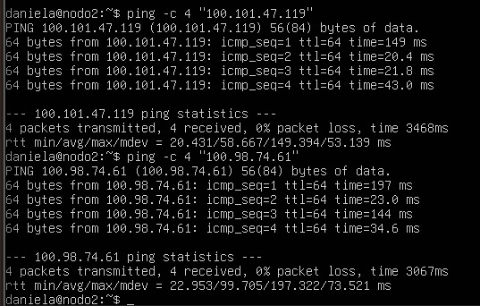
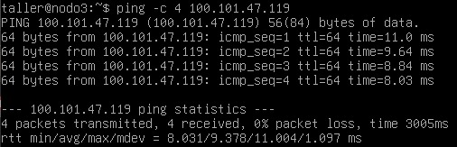
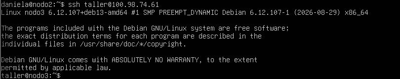
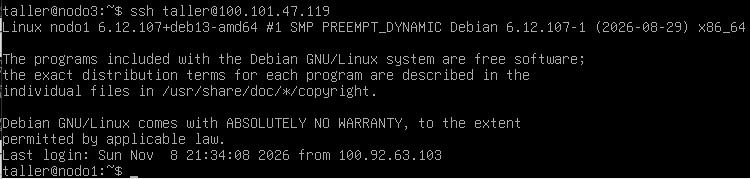
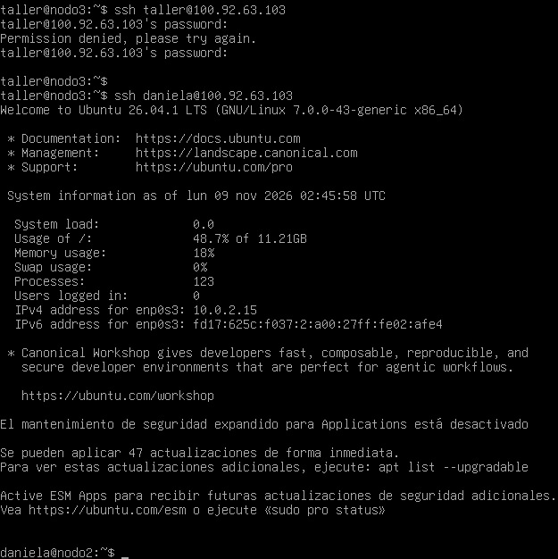
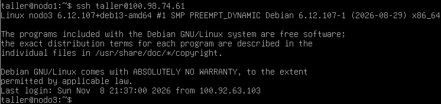
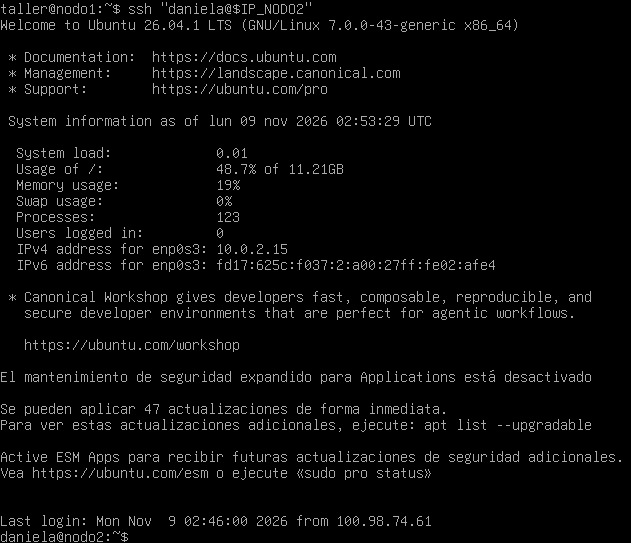
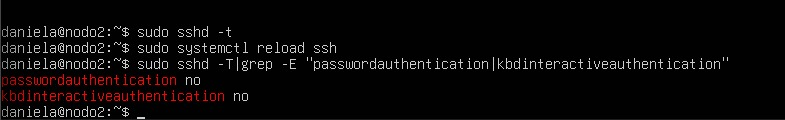
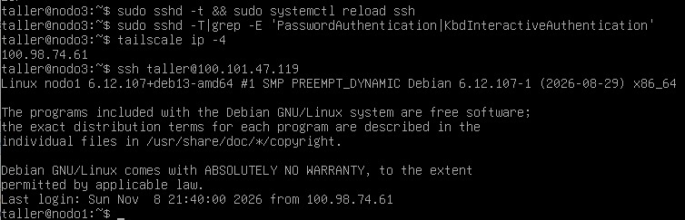
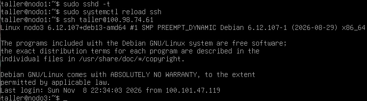

# Conexión entre nodos y configuración de SSH

Este documento reúne la evidencia del entregable **E3: verificación inicial de conectividad**. Las capturas muestran pruebas de ping entre los nodos, acceso SSH mediante clave pública a través de Tailscale y la configuración de SSH en los tres nodos.

## 1. Verificación de conectividad mediante ping

### Ping de nodo 2 a nodo 1 y nodo 3

### Ping de nodo 3 a nodo 1

## 2. Verificación de conectividad mediante SSH

### Conexión de nodo 2 a nodo 1

### Conexión de nodo 2 a nodo 3

### Conexión de nodo 3 a nodo 1

### Conexión de nodo 3 a nodo 2

### Conexión de nodo 1 a nodo 3

### Conexión de nodo 2 a nodo 3

## 3. Configuración de autenticación SSH

Las siguientes capturas documentan la configuración de SSH para deshabilitar la autenticación por contraseña (`PasswordAuthentication no`).

### Nodo 2

### Nodo 3

### Nodo 1

