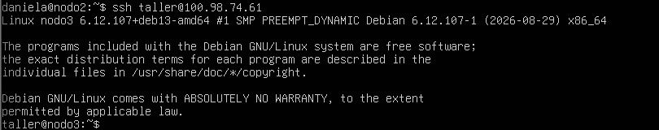
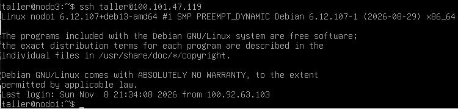
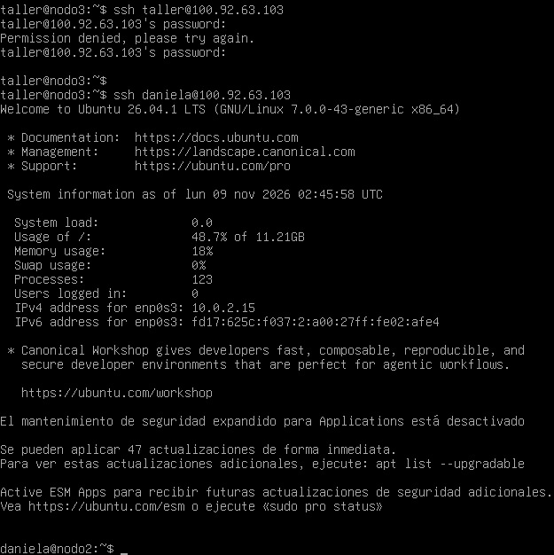
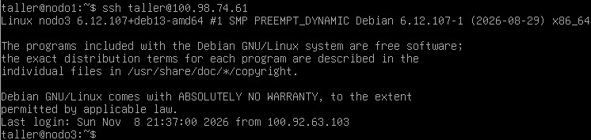
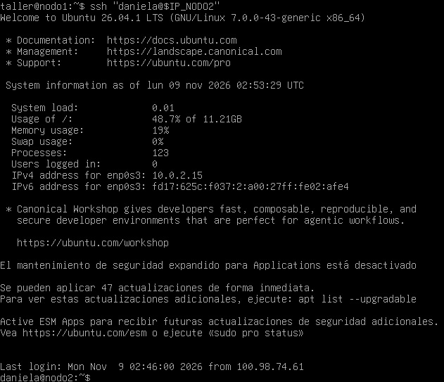
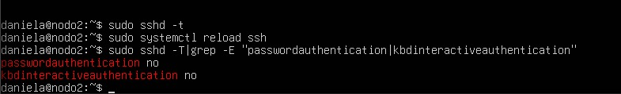
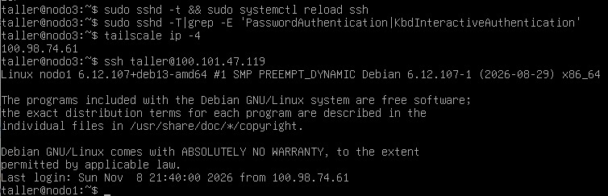
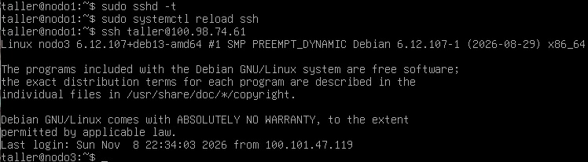

# CONEXIÓN EXITOSA ENTRE NODOS Y CONFIGURACIÓN SSH

A continuación se evidencia el cumplimiento del Entregable E3 (Registro de la verificación de conectividad inicial). Se demuestra el acceso SSH por clave pública entre todos los nodos del grupo a través de las IP de Tailscale y la desactivación de la autenticación por contraseña.

## 1. Verificación de conectividad general

Aquí se evidencia la conexión del Nodo 2 con el Nodo 1 y con el Nodo 3:

Aquí se evidencia la conexión del Nodo 3 con el Nodo 2 y con el Nodo 1:

## 2. Verificación de conectividad bidireccional

**Conexiones desde el Nodo 2:**
- Hacia el Nodo 1:
  
- Hacia el Nodo 3:
  

**Conexiones desde el Nodo 3:**
- Hacia el Nodo 1:
  
- Hacia el Nodo 2:
  

**Conexiones desde el Nodo 1:**
- Hacia el Nodo 3:
  
- Hacia el Nodo 2:
  

## 3. Desactivación de contraseñas SSH

Para cumplir con los requisitos del entorno, se deshabilitó el acceso por contraseña editando el archivo `/etc/ssh/sshd_config` y configurando `PasswordAuthentication no`.

- **Desactivación en Nodo 2:**
  

- **Desactivación en Nodo 3:**
  

- **Desactivación en Nodo 1:**
  
