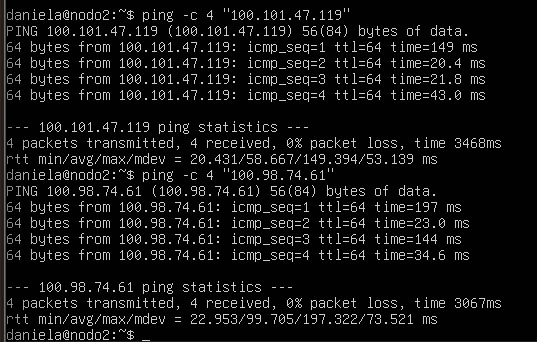
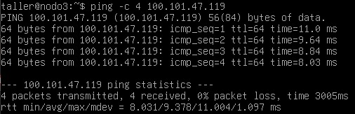

# CONEXON EXITOSA ENTRE NODOS 

Aqui se evidencia la conexion del Nodo2 con el Nodo1 y con el Nodo3 (Imagen1.jpeg)

Aqui se evidencia la conexion del Nodo3 con el Nodo2 y con el Nodo1 (Imagen2.jpeg)

